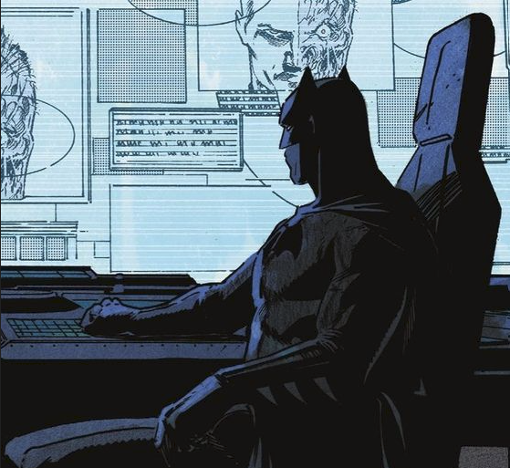

<h1 align="center"><code>~Welcome~</code> </h1>

<h2 align="center"><i>About Me</i></h2>

  <b>Name:</b> Abdumjeed 
  🎓 AI student · 🤖 Learning how machines think

<h2 align="center"><i>What I Know</i></h2>

 

<h2 align="center"><i>Currently Learning</i></h2>

  📚 Always learning more, and new skills will be added here soon ⏳

<h2 align="center"><i>Projects</i></h2>

  🚀 <a href="https://github.com/barvlk/AgentForStudent"><b>AgentForStudent</b></a> — Python

  
  
  

<i>"I'm the one who watches from the shadows... and codes in the dark." 🌑</i>

